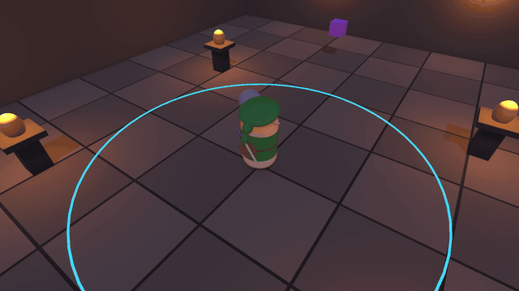

# Link te señala lo importante con la mirada

> Mira la cabeza de Link. ¿Por qué gira justo ahí?

## Qué muestra este proyecto
Recreación en Unity de un truco de diseño de Zelda: la cabeza del personaje gira hacia los puntos de interés (un ojo en la
pared, un cuadro) y le señala al jugador algo que de otro modo pasaría desapercibido, sin una sola línea de texto.
Capas de debug para ver la regla (radio de interés, ángulo, límite del cuello, línea de la mirada) y un antes y después
con la pista encendida y apagada. Es una recreación propia, no el código de Nintendo: los valores son nuestros.

## Vídeo
- Vídeo completo: [La ayuda invisible de Zelda que siempre ignoraste](https://youtu.be/jUFZhUF-pbY)
- Short: _enlace_

## Cómo probarlo
1. Clona el repositorio.
2. Ábrelo con Unity 6.4.
3. Abre una escena de `Assets/_Project/Scenes` y pulsa Play:
   - `Stairs`: sube la escalera y fíjate en la cabeza al pasar junto al ojo de la pared (y arriba, ante los dos cuadros).
   - `Paintings`: pasa por delante de cinco cuadros iguales; la cabeza solo mira el que importa.
   - `Rule`: un cubo entra y sale del radio para ver la regla paso a paso.

### Controles
| Tecla | Qué hace |
|---|---|
| WASD / flechas / stick izquierdo | Mover a Link |
| Q / E, botón derecho del ratón, stick derecho | Girar la cámara (rueda: acercar y alejar) |
| Tab | Todas las capas de debug |
| 1 · 2 · 3 · 4 | Radio · ángulo y límite del cuello · línea de la mirada · candidatos |
| H | Pista de la mirada encendida / apagada (el antes y después) |
| T | Giro de cabeza suave / brusco |
| P | Recorrido fijo (el de las tomas del vídeo); cualquier dirección te devuelve el control |
| R | Volver al principio |

Los valores de la regla (radio, ángulo de atención, límite del cuello, velocidad de giro) se cambian en el componente
`GazeController` del personaje. Para que un objeto llame la atención, añádele un `InterestMarker`.

## Estructura
- `Assets/_Project/Scripts` — código (Domain, Application, Presentation, Infrastructure, Editor, Tests)
- `Assets/_Project/Scenes` — escenas de demostración
- `Docs` — imágenes y GIFs del README

## Licencia
MIT — consulta [LICENSE](LICENSE).